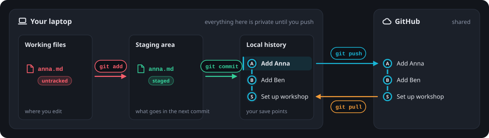
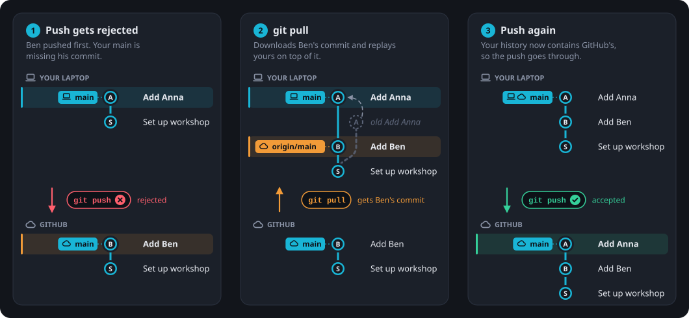
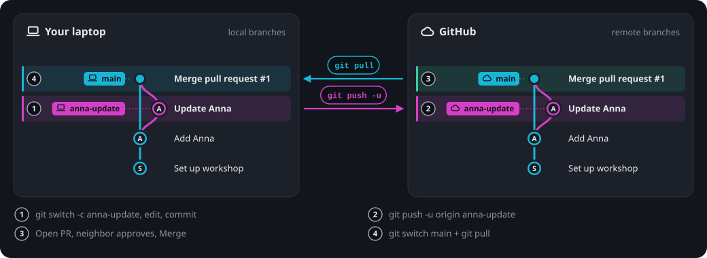

# Git Workshop

In 30 minutes you'll make commits, push them to GitHub, and open a pull request.

## The big picture



Each dot is a commit; the letter is who made it (**A**nna, **B**en, **S**etup). Tags show where a branch points: 💻 on your laptop, ☁️ on GitHub.

A commit is a save point. Push uploads your save points to GitHub; pull downloads everyone else's.

> [!TIP]
> **Golden rule: run `git status` after every step.** It tells you what's going on.

## Setup (once)

> [!IMPORTANT]
> **Before the workshop:** install and configure git with [git-setup.md](git-setup.md). If you did, skip the `git config` lines below and start at `git clone`.

> [!TIP]
> If you want to keep your email private, check https://github.com/settings/emails and use the email provided there instead of your private email. It would look something like `141524111+Arseni10Lk@users.noreply.github.com`

```
git config --global user.name "Your Name"
git config --global user.email "you@example.com"
git config --global pull.rebase true
git clone https://github.com/knnmelprop/git-workshop.git
cd git-workshop
git log --oneline
```

## Task 1: Your first commit

1. Create the file `members/<your-name>.md` (lowercase, no spaces, e.g. `members/anna-kowalska.md`). Copy the format from `members/example.md`.
2. `git status`: your file is listed as **untracked** (red).
3. `git add members/<your-name>.md`
4. `git status`: your file is now **staged** (green).
5. `git commit -m "Add <your name>"`
6. `git log --oneline`: your commit is at the top.

## Task 2: Push to GitHub

1. `git push`
2. Rejected with "fetch first"? Someone pushed before you. Run `git pull`, then `git push` again.
3. Open the repo on GitHub and find your file in `members/`.

Why a push gets rejected: everyone pushes to the same `main`. If a classmate got there first, your laptop is missing their commit.



## Task 3: Pull request

1. Create a branch: `git switch -c <your-name>-update`
2. Add a line to your file: `What I'd use git for: ...`
3. `git diff`: see exactly what you changed.
4. `git add members/<your-name>.md` and `git commit -m "Update <your name>"`
5. `git push -u origin <your-name>-update`
6. Open the link git printed (or click **Compare & pull request** on the repo page) and create the pull request.
7. Accept your neighbor's PR: open **their** PR, go to **Files changed** → **Review changes**, write a short comment, choose **Approve**, and submit.
8. Once your PR is approved, click **Merge pull request** → **Confirm merge**.
9. Back in the terminal:
   ```
   git switch main
   git pull
   ```
   Your change is now on main.



## Cheat sheet

| Command | What it does |
|---|---|
| `git clone <url>` | Download a repository |
| `git status` | Show what changed and what's staged |
| `git add <file>` | Stage a file for the next commit |
| `git commit -m "msg"` | Save staged changes as a commit |
| `git log --oneline` | Show commit history |
| `git diff` | Show unstaged changes |
| `git push` | Upload your commits to GitHub |
| `git pull` | Download others' commits |
| `git switch -c <name>` | Create and switch to a new branch |
| `git switch main` | Go back to main |

## Stuck?

- **"not a git repository"**: you're in the wrong folder. Run `cd git-workshop`.
- **"nothing added to commit"**: you forgot `git add`.
- **A weird editor opened (vim)**: type `:wq` and press Enter.
- **Asked for a password when pushing**: GitHub doesn't accept passwords. Ask a helper.
- **`git switch` not recognized**: your git is old. Use `git checkout -b <name>` instead.
- **Push rejected**: `git pull`, then `git push`.

<!-- Diagrams are generated: edit docs/diagrams/generate.mjs, then run `node docs/diagrams/generate.mjs`. -->
